<div align="center">

# The Harness Is Half the Agent

**A short story on LLM agent harness engineering, built from four survey papers posted between June and October 2026**

[][medium]
[][slideshare]
[][youtube]

[](https://arxiv.org/abs/2606.20683)
[](https://arxiv.org/abs/2607.13104)
[](https://arxiv.org/abs/2608.20485)
[](https://arxiv.org/abs/2611.23260)


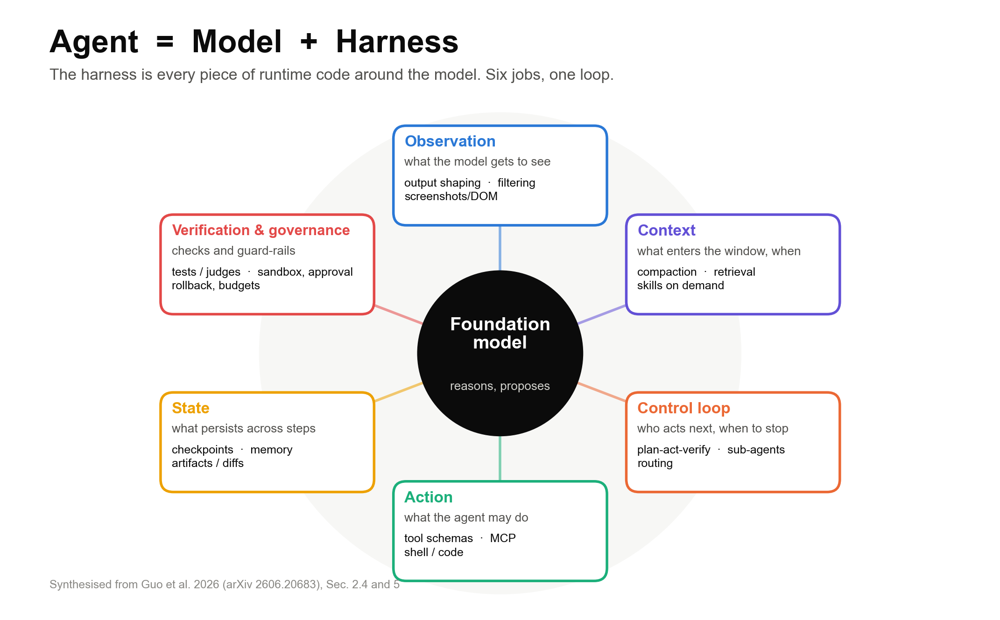

</div>

> **The idea in one line.** On Terminal-Bench 2.0, Claude Opus 4.6 scores **58.0%** inside Claude Code and **76.4%** inside Meta-Harness, with the same weights on the same tasks. A benchmark score belongs to the *model plus its harness*, and four 2026 surveys explain why.

---

## Contents

- [Deliverables](#deliverables)
- [The four surveys](#the-four-surveys)
- [The taxonomy at a glance](#the-taxonomy-at-a-glance)
- [Key findings, with figures](#key-findings-with-figures)
- [Techniques behind the top leaderboard entries](#techniques-behind-the-top-leaderboard-entries)
- [Metrics that matter](#metrics-that-matter)
- [My two cents](#my-two-cents)
- [Repository layout](#repository-layout)
- [Reproduce every figure](#reproduce-every-figure)
- [Data provenance and accuracy](#data-provenance-and-accuracy)
- [Rubric checklist](#rubric-checklist)
- [References](#references)

---

## Deliverables

| | Deliverable | Where |
|:-:|---|---|
| 📝 | **Medium article** (written from scratch, ~4,300 words, 20 figures) | [Medium][medium] · source: [`article/medium_article.md`](article/medium_article.md) |
| 📊 | **Slide deck** (27 slides, full speaker notes) | [SlideShare][slideshare] · [`slides/harness_short_story.pptx`](slides/harness_short_story.pptx) · [`slides/harness_short_story.pdf`](slides/harness_short_story.pdf) |
| 🎥 | **Video presentation** (~17 min) | [YouTube][youtube] · recording guide and file: [`video/`](video/) |
| 🗣️ | **Word-for-word talk script** with timings | [`video/presentation_script.md`](video/presentation_script.md) |
| 📈 | **Data and plotting code** for every chart | [`data/`](data/) · [`scripts/`](scripts/) |
| ✅ | **Rubric checklist** | [`RUBRIC_CHECKLIST.md`](RUBRIC_CHECKLIST.md) |

---

## The four surveys

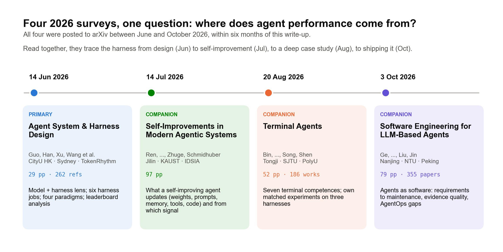

| Role | Survey | Authors (lead … senior) and affiliations | Posted | Size |
|---|---|---|---|---|
| ⭐ **Primary** | [From Question Answering to Task Completion: A Survey on Agent System and Harness Design](https://arxiv.org/abs/2606.20683) | Jianyuan Guo … Kai Han, Chang Xu, Yunhe Wang · CityU Hong Kong, Univ. of Sydney, TokenRhythm, Peking Univ. | 14 Jun 2026 | 29 pp, 262 refs |
| Companion | [Self-Improvements in Modern Agentic Systems: A Survey](https://arxiv.org/abs/2607.13104) | Zhe Ren … Mingchen Zhuge, Jürgen Schmidhuber · Jilin, KAUST, IDSIA | 14 Jul 2026 | 97 pp |
| Companion | [Terminal Agents: A Survey of AI Agents in Command-Line Environments](https://arxiv.org/abs/2608.20485) | Yi Bin … Jingkuan Song, Heng Tao Shen · Tongji, SJTU, PolyU | 20 Aug 2026 | 52 pp, 186 works |
| Companion | [Software Engineering for LLM-Based Agents: A Lifecycle-Oriented Survey](https://arxiv.org/abs/2611.23260) | Yifei Ge … Yang Liu, Zhi Jin · Nanjing, NTU, Peking | 3 Oct 2026 | 79 pp, 355 papers |

**Why these four.** The assignment asked for recent surveys (last 3–6 months) from strong groups on generative-AI engineering topics such as agents, tool use, evaluation and LLMOps. All four were posted within six months of 19 Nov 2026. Together they cover one theme end to end: how to **design** a harness, how a harness can **improve itself**, how harnesses behave in a hard real setting (**terminals**), and how to **ship and maintain** them (AgentOps).

---

## The taxonomy at a glance

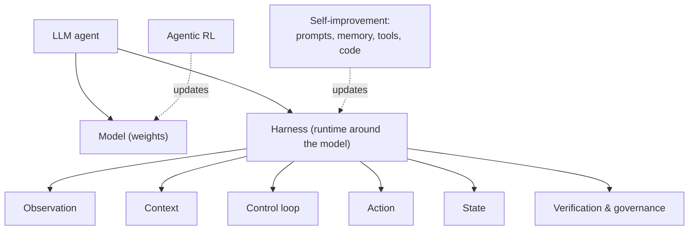

| Survey | Its main taxonomy |
|---|---|
| Harness design | **4 paradigms** (prompt → context/workflow → harness → agent-native training) · **6 harness responsibilities** · **4 task levels** (L1 single-step … L4 open-ended) · task property → failure pressure → harness response |
| Self-improvement | Agent = (weights θ, scaffold Σ = prompts, memory, tools, control) · organised by **what is updated** × **which signal** drives it |
| Terminal agents | **4 architecture layers** · **7 competences** (command formulation, feedback use, runtime management, state tracking, verification, recovery, governance) · 7 benchmark families |
| SE for agents | **5 lifecycle stages** (requirements, architecture, implementation, testing, maintenance) · E0–E4 evidence ladder |

<table>
<tr>
<td width="50%">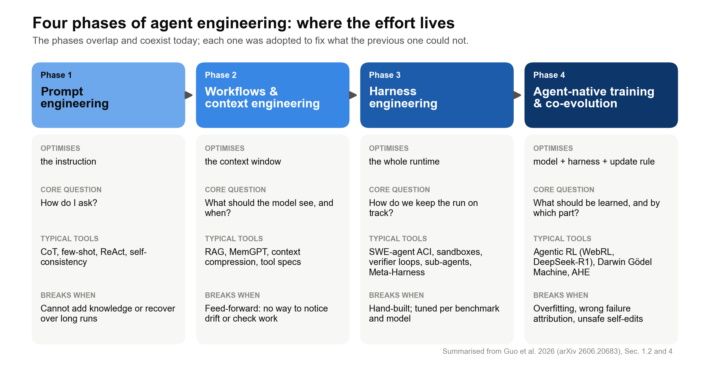</td>
<td width="50%">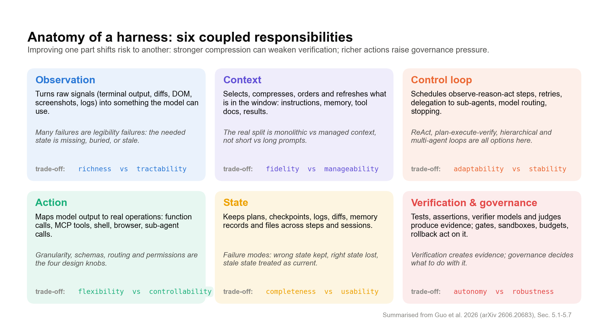</td>
</tr>
<tr>
<td>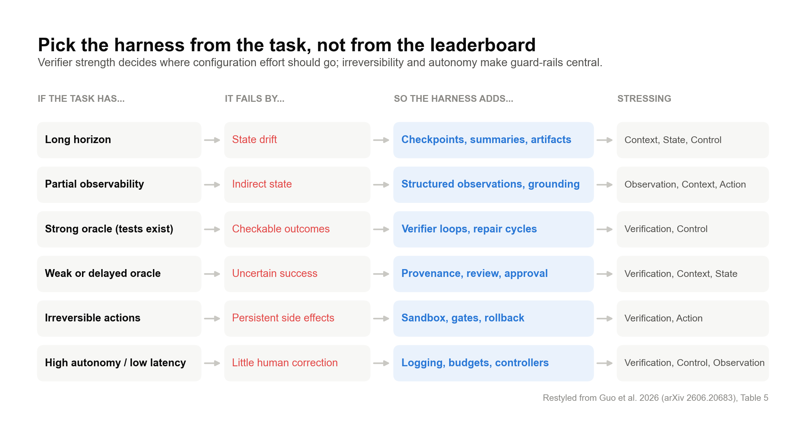</td>
<td>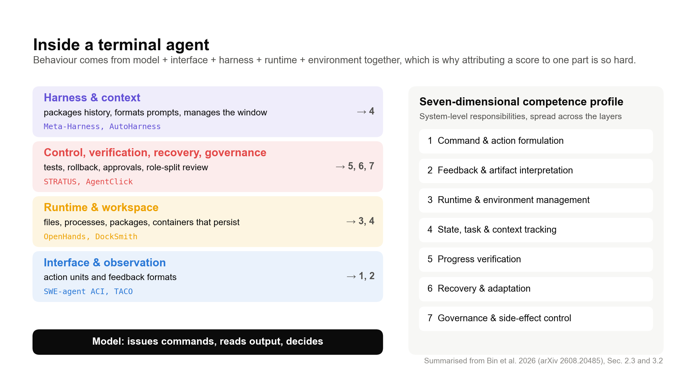</td>
</tr>
<tr>
<td>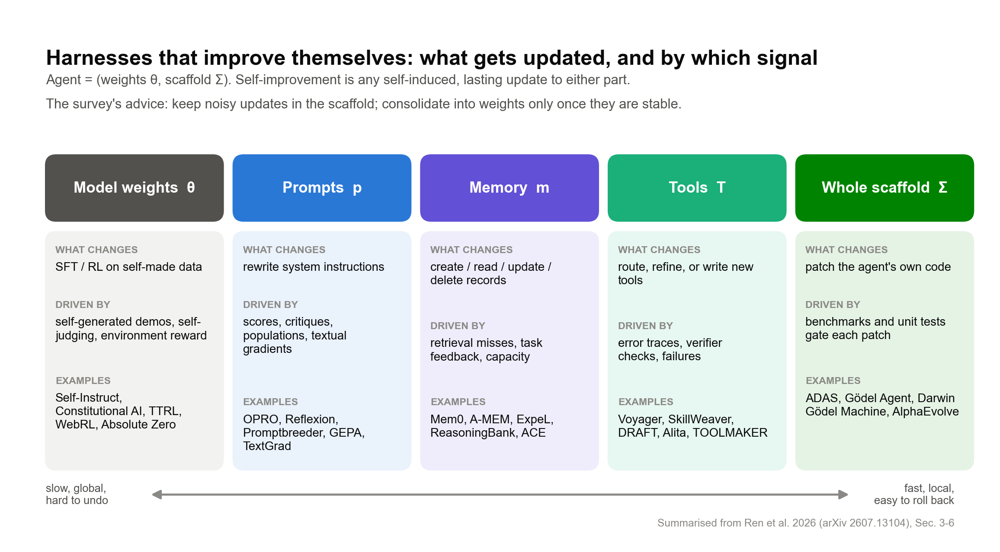</td>
<td>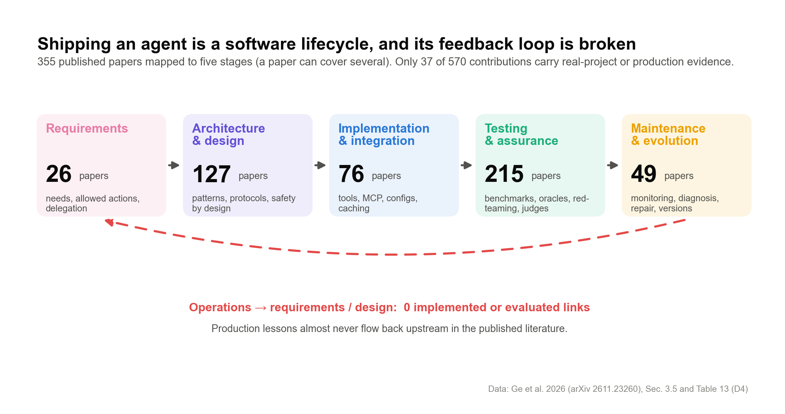</td>
</tr>
</table>

---

## Key findings, with figures

**1. Both levers are about the same size.** On public Terminal-Bench 2.0 results, swapping the harness moves a model by a median of 13.6 points across 20 models (13.7–20.8 for the three showcased models). One model-generation step inside a fixed harness adds 11–19 points, and two or three steps add about 30.

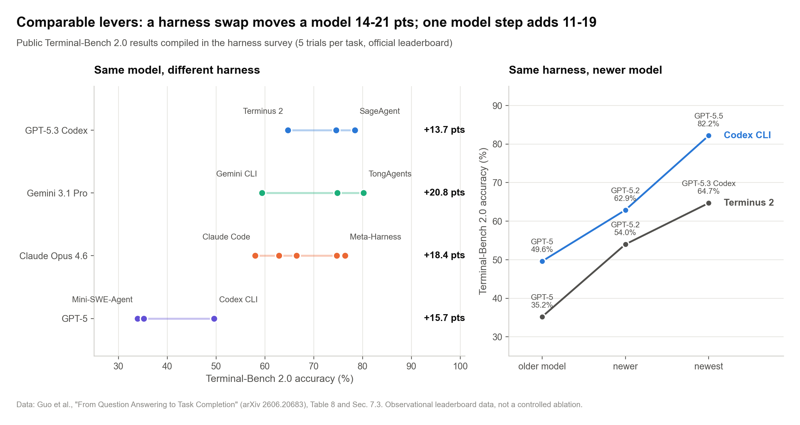

**2. In a matched comparison, the harness beat the model tier.** With DeepSeek-V4 Flash and Pro under three harnesses on identical tasks, the model tier moved results by at most 2.5 points (not significant), and the harness moved them by up to 21.25 points. The size of the harness effect depended on the benchmark.

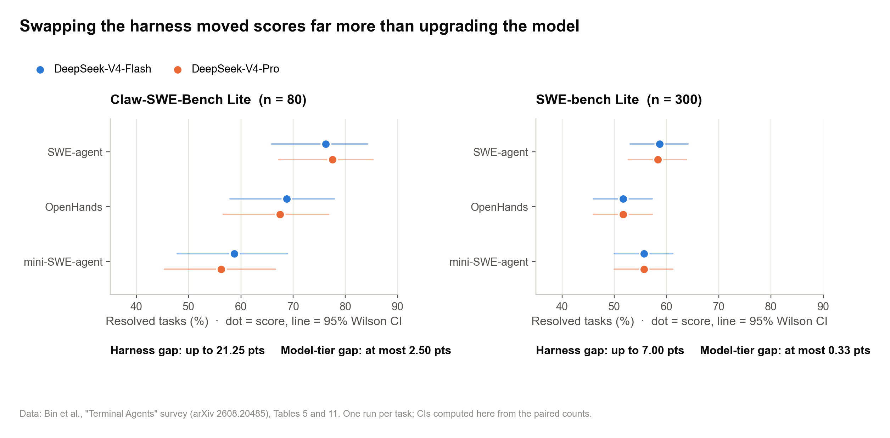

**3. Better harnesses cost more.** Meta-Harness reads about 9.5 times the input tokens of Terminus 2 for Opus 4.6, and in exchange gains 13.5 points and halves timeouts.

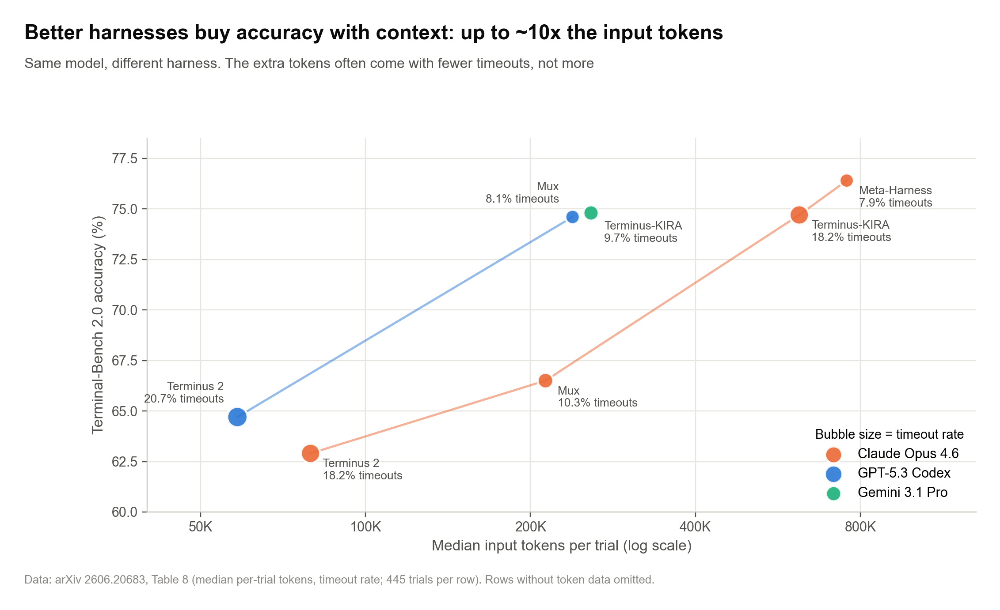

<table>
<tr>
<td width="50%"><b>4. On the web the lift is largest</b> (upper bounds)<br>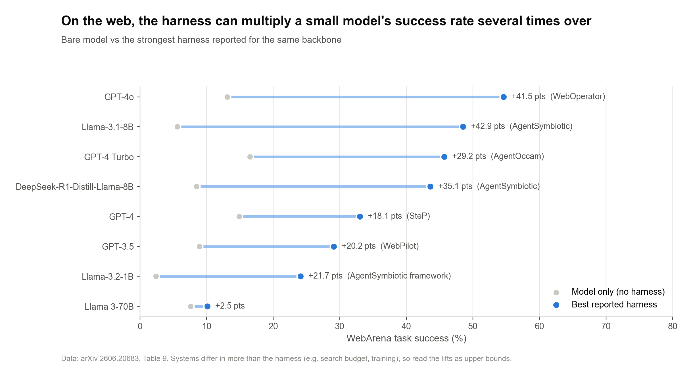</td>
<td width="50%"><b>5. Each benchmark exposes a different weakness</b><br>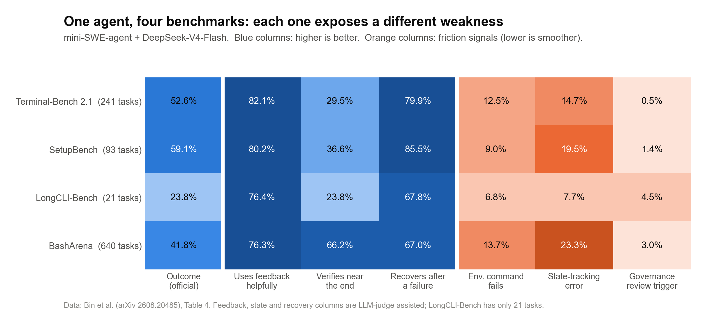</td>
</tr>
<tr>
<td><b>6. Governance is the blind spot</b><br>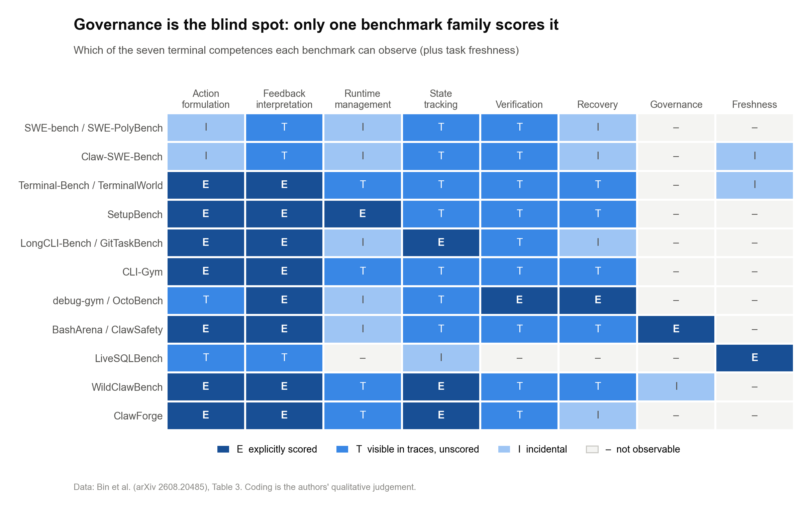</td>
<td><b>7. A self-edited harness: 20% → 50% on SWE-bench</b><br>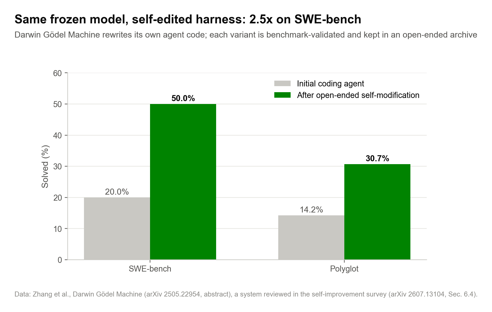</td>
</tr>
<tr>
<td><b>8. Agent memory rarely deletes</b> (16 of 25 systems)<br>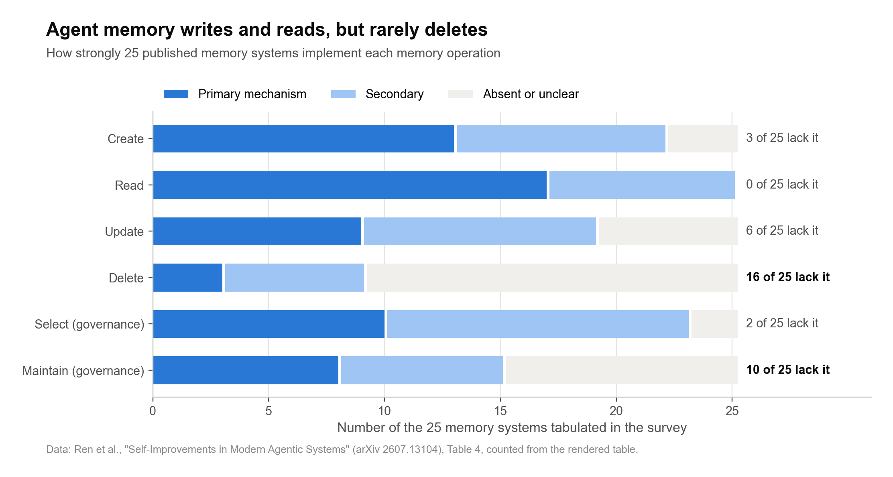</td>
<td><b>9. Real-world evidence is a sliver</b> (37 of 570 contributions)<br>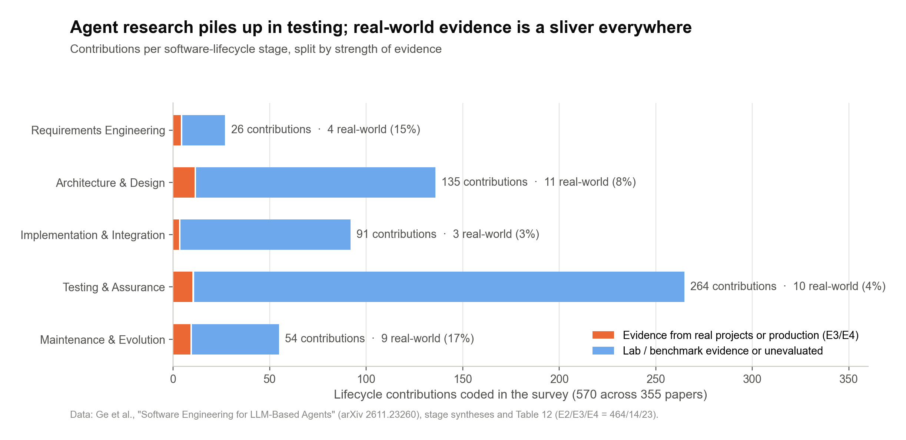</td>
</tr>
<tr>
<td><b>10. The field is young</b><br>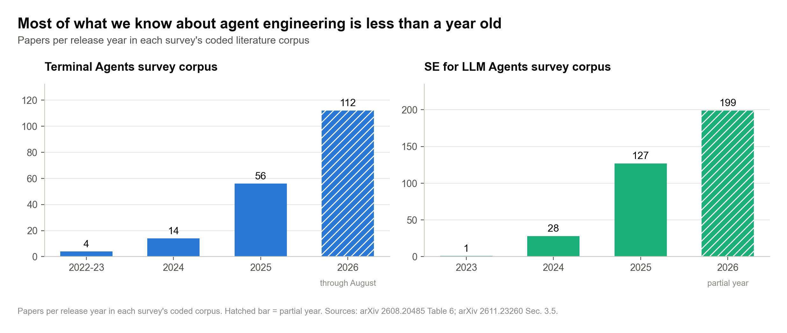</td>
<td><b>11. Harness rankings flip</b> (live boards, 19 Nov 2026)<br>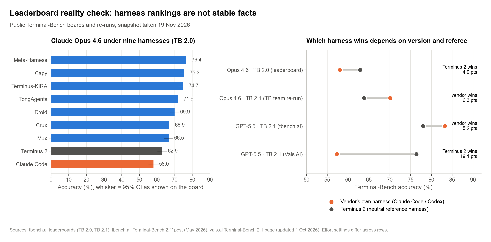</td>
</tr>
</table>

---

## Techniques behind the top leaderboard entries

| Technique | What it does | Examples from the surveys and boards |
|---|---|---|
| **Searched / generated harness** | Treat prompts, tools and runtime policy as a search space, or let an agent write its own scaffold | Meta-Harness, SageAgent, AHE, Darwin Gödel Machine |
| **Agent-Computer Interface (ACI)** | Small, model-legible search/view/edit commands instead of raw shell | SWE-agent, mini-SWE-agent (~100 lines) |
| **Verify before "done"** | Completion checks and test runs built into the loop | Terminus-KIRA; verify-and-repair loops in coding agents |
| **Structured pipelines** | Fixed localize → repair → validate stages when a strong oracle exists | Agentless, PatchPilot, AutoCodeRover |
| **Managed context** | Compaction, folding finished sub-tasks, skills loaded on demand, state written to files | MemGPT, Context-Folding, Git-style context control |
| **Sandbox + approvals + rollback** | Governance for irreversible actions | Claude Code, Codex CLI permission modes; BashArena-style evaluation |

---

## Metrics that matter

| Metric | Why | Source |
|---|---|---|
| Success rate **with a 95% CI** | Single runs mislead | terminal survey; self-improvement survey (seed variance) |
| **pass@k and pass^k** (all-pass@k) | Capability vs reliability | SE survey |
| **Cost per successful task** | Real economics | harness survey (value-aware objective) |
| Median tokens, wall-clock, **timeout rate** | Where the budget goes | harness survey, Table 8 |
| Final-window **verification** rate · **recovery** rate · **governance** triggers | Process quality | terminal survey (P5, P6, P7) |
| **Regression** on solved tasks | Did the update break something | self-improvement survey |
| **Policy-compliant completion** | Success that also obeyed the rules | SE survey |

---

## My two cents

1. **"It's the harness, not the model" is half true.** One model-generation step adds 11–19 points in a fixed harness, about the same as the median harness spread. The model sets the ceiling, and the harness decides how much of it you reach.
2. **Harness rankings are not stable facts.** Opus 4.6's Claude Code vs Terminus 2 order flips between TB 2.0 and the TB 2.1 re-run; GPT-5.5's Codex vs Terminus 2 order flips between tbench.ai and Vals AI.
3. **Vendor CLIs at the bottom is not a scandal.** They are built for interactive, permissioned use, while top leaderboard harnesses are tuned, and sometimes literally searched, against the benchmark.
4. **Cost is the missing axis.** Only 15.2% of Terminal-Bench trial records carry dollar cost. On TB 2.1, GPT-5.5 in Codex spends about 4× what it spends in Terminus 2 (≈$2.1k vs ≈$0.5k) for about 5 more points.
5. **Governance, deletion and feedback are blind spots.** One benchmark family scores governance; 16 of 25 memory systems have no clear delete step; none of 355 papers implements and evaluates a path from operations back to requirements.

My proposal is a **harness report card** for every agent result:

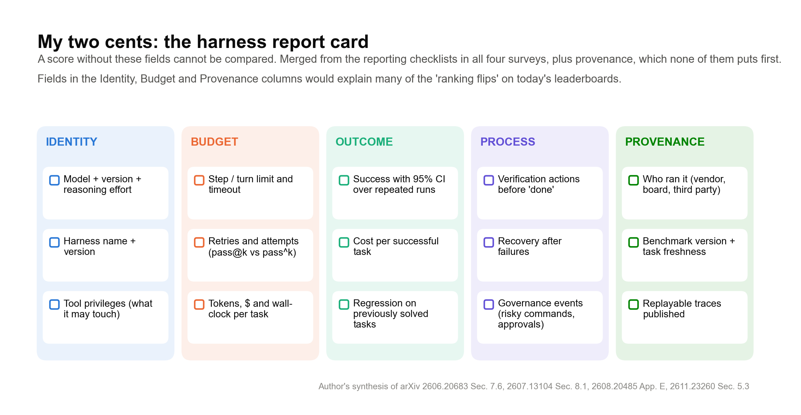

---

## Repository layout

```text
agent-harness-engineering-survey/
├── README.md                     ← you are here
├── RUBRIC_CHECKLIST.md           ← every assignment requirement mapped to an artifact
├── article/
│   ├── medium_article.md         ← the Medium story (source of truth)
│   └── medium_article.html       ← paste-ready version for the Medium editor
├── slides/
│   ├── harness_short_story.pptx  ← 27-slide deck with speaker notes
│   ├── harness_short_story.pdf   ← SlideShare upload
│   ├── build_deck.js             ← generates the deck (pptxgenjs)
│   └── speaker_notes.json        ← narration, one entry per slide
├── video/
│   ├── README.md                 ← how to record, compress and upload the talk
│   └── presentation_script.md    ← word-for-word, timed script (~17 min)
├── figures/
│   ├── charts/                   ← 11 data charts
│   └── diagrams/                 ← 9 explanatory diagrams
├── data/                         ← every number behind every chart, with its source table
├── scripts/                      ← matplotlib code that draws all figures
├── papers/README.md              ← reading list with links (PDFs are not redistributed)
└── tools/
    ├── update_links.py           ← fills Medium / SlideShare / YouTube links everywhere
    ├── build_medium_html.py      ← rebuilds the paste-ready Medium HTML
    ├── export_script.py          ← regenerates the timed talk script from the deck
    └── compress_video.sh         ← shrinks the recording below GitHub's 100 MB limit
```

---

## Reproduce every figure

```bash
python3 -m venv .venv && source .venv/bin/activate
pip install -r requirements.txt
python scripts/charts_papers.py     # charts from the surveys' own tables
python scripts/charts_harness.py    # leaderboard, self-improvement and live-board charts
python scripts/diagrams.py          # the nine explanatory diagrams
```

Rebuild the deck and the talk script (Node 18+):

```bash
cd slides && npm install && cd ..
NODE_PATH=slides/node_modules node slides/build_deck.js   # writes slides/harness_short_story.pptx
python tools/export_script.py                              # writes video/presentation_script.md
```

Export the PDF from PowerPoint, Keynote or LibreOffice (File → Export → PDF).

---

## Data provenance and accuracy

- Every chart reads a CSV in [`data/`](data/), and each CSV names the paper table or web page its numbers came from. See [`data/README.md`](data/README.md).
- Survey numbers were checked against the arXiv text line by line. Where I computed something (for example Wilson confidence intervals from paired counts, or a ratio of two reported values), the chart caption says so.
- Live leaderboard numbers are a **snapshot taken on 19 Nov 2026** from tbench.ai and vals.ai. Those boards change.
- Problems I found in the surveys are noted in the article's "My two cents" section rather than silently corrected.

---

## Rubric checklist

The full mapping is in [`RUBRIC_CHECKLIST.md`](RUBRIC_CHECKLIST.md). In short:

| Requirement | Status |
|---|---|
| Survey papers from the last 3–6 months, strong authors, gen-AI engineering topic | ✅ four arXiv surveys, Jun–Oct 2026 |
| Main taxonomy summarised; leaderboard techniques explained | ✅ article Parts 1–5, slides 5–19 |
| Article written from scratch, focused on architecture, ablations and metrics, with many visuals and my own two cents | ✅ 20 original figures, "My two cents" section |
| More survey content combined | ✅ three companion surveys plus live leaderboards |
| Medium article published | ⏳ [link][medium] |
| Slide deck on SlideShare | ⏳ [link][slideshare] |
| 10–15+ min video in this repo and on YouTube | ⏳ [link][youtube] · script ready |
| Public GitHub repo with a proper README, link added to the class spreadsheet | ✅ this repo · ⏳ spreadsheet |

---

## References

1. J. Guo *et al.*, "From Question Answering to Task Completion: A Survey on Agent System and Harness Design," arXiv:2606.20683, 2026.
2. Z. Ren *et al.*, "Self-Improvements in Modern Agentic Systems: A Survey," arXiv:2607.13104, 2026.
3. Y. Bin *et al.*, "Terminal Agents: A Survey of AI Agents in Command-Line Environments," arXiv:2608.20485, 2026.
4. Y. Ge *et al.*, "Software Engineering for LLM-Based Agents: A Lifecycle-Oriented Survey," arXiv:2611.23260, 2026.
5. J. Zhang *et al.*, "Darwin Gödel Machine: Open-Ended Evolution of Self-Improving Agents," arXiv:2505.22954.
6. Terminal-Bench leaderboards and posts, [tbench.ai](https://www.tbench.ai); Vals AI Terminal-Bench 2.1, [vals.ai](https://www.vals.ai/benchmarks/terminal-bench-2-1). Accessed 19 Nov 2026.

<sub>Text and figures: CC BY 4.0. Code: MIT. See [LICENSE](LICENSE). The surveys belong to their authors; this repository summarises and comments on them.</sub>

[medium]: article/medium_article.md
[slideshare]: slides/harness_short_story.pdf
[youtube]: video/README.md
