# The Harness Is Half the Agent

### What four 2026 surveys say about building LLM agents that actually finish the job, and what the leaderboards really show

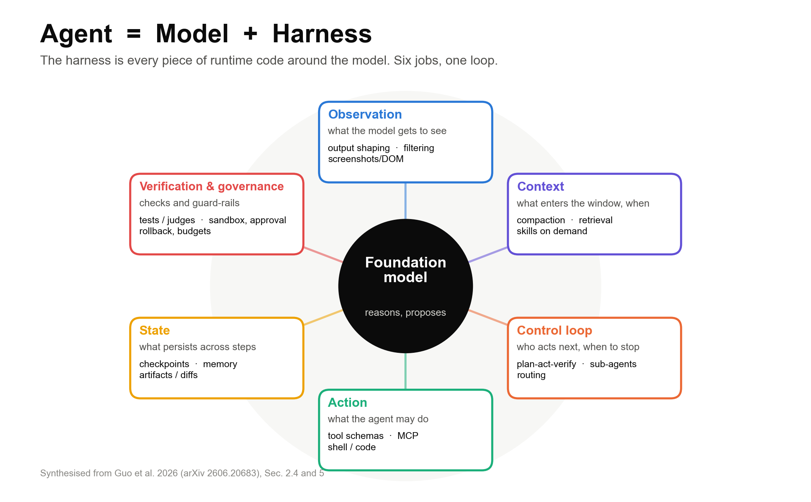

Here is a number that should change how you read AI leaderboards. On Terminal-Bench 2.0, Claude Opus 4.6 solves **58.0%** of tasks when it runs inside Claude Code and **76.4%** when it runs inside Meta-Harness. It is the same model, with the same weights, on the same task set. The only thing that changed is the code wrapped around it.

That wrapper has a name now: the **harness**. It decides what the model sees, what it is allowed to do, what it remembers, when it stops, and how its work gets checked. In 2026, "harness engineering" went from a phrase in engineering blogs to the organizing idea of several serious surveys. I read four of them, all posted to arXiv between June and October 2026, and this article is my attempt to pull them into one picture: the taxonomy, the techniques behind the top leaderboard entries, the ablation-style evidence, the metrics that matter, and where I think the story is weaker than it sounds.

**TL;DR**

- An agent is a model plus a harness, and a benchmark score belongs to the pair, not to the model.
- The harness has six jobs: observation, context, control, action, state, and verification/governance. Each one has a trade-off, and fixing one tends to push risk into another.
- On public leaderboards the harness moves a fixed model by roughly 14 to 21 points. A model generation upgrade inside a fixed harness moves it by about 30. Both levers are big.
- In a controlled experiment, swapping the harness changed results by up to 21 points while upgrading the model tier changed them by at most 2.5.
- Harness rankings are not stable. They flip when the benchmark version changes and when a different team runs the evaluation.
- The weakest parts of current practice are cost reporting, governance, forgetting, and feeding production lessons back into design.

---

## The four surveys

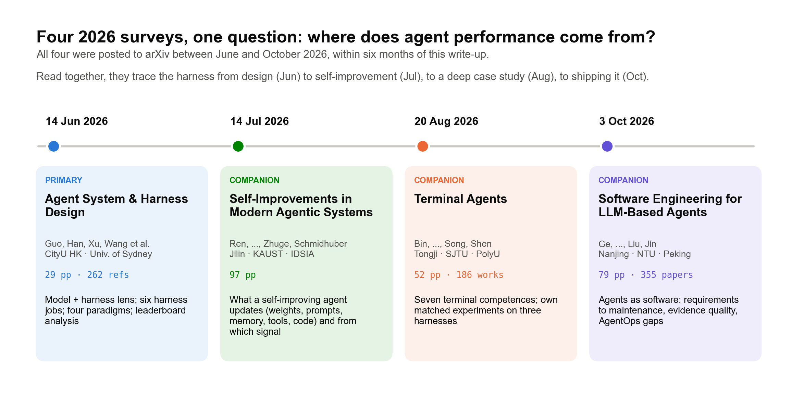

| # | Survey | Authors (lead → senior) | Posted | Why it is here |
|---|---|---|---|---|
| 1 | *From Question Answering to Task Completion: A Survey on Agent System and Harness Design* ([arXiv 2606.20683](https://arxiv.org/abs/2606.20683)) | Jianyuan Guo … Kai Han, Chang Xu, Yunhe Wang (CityU Hong Kong, Univ. of Sydney, Peking Univ.) | 14 Jun 2026 | **Primary.** Gives the model-plus-harness formalism, the six-part anatomy, and a leaderboard analysis across SWE-bench, Terminal-Bench and WebArena. |
| 2 | *Self-Improvements in Modern Agentic Systems: A Survey* ([arXiv 2607.13104](https://arxiv.org/abs/2607.13104)) | Zhe Ren … Mingchen Zhuge, Jürgen Schmidhuber (Jilin, KAUST, IDSIA) | 14 Jul 2026 | What happens when the harness rewrites itself: prompts, memory, tools and code. |
| 3 | *Terminal Agents: A Survey of AI Agents in Command-Line Environments* ([arXiv 2608.20485](https://arxiv.org/abs/2608.20485)) | Yi Bin … Jingkuan Song, Heng Tao Shen (Tongji, SJTU, PolyU) | 20 Aug 2026 | A deep case study of one environment, with the authors' own matched harness experiments. |
| 4 | *Software Engineering for LLM-Based Agents: A Lifecycle-Oriented Survey* ([arXiv 2611.23260](https://arxiv.org/abs/2611.23260)) | Yifei Ge … Yang Liu, Zhi Jin (Nanjing, NTU, Peking) | 3 Oct 2026 | The AgentOps view: how agents are specified, tested, monitored and maintained as software. |

Read in order, they follow a harness from design, to self-improvement, to a hard real-world setting, to shipping and maintenance. They also show how young this literature is. In two of the surveys' own corpora, most of the papers they review were released in 2026 alone.

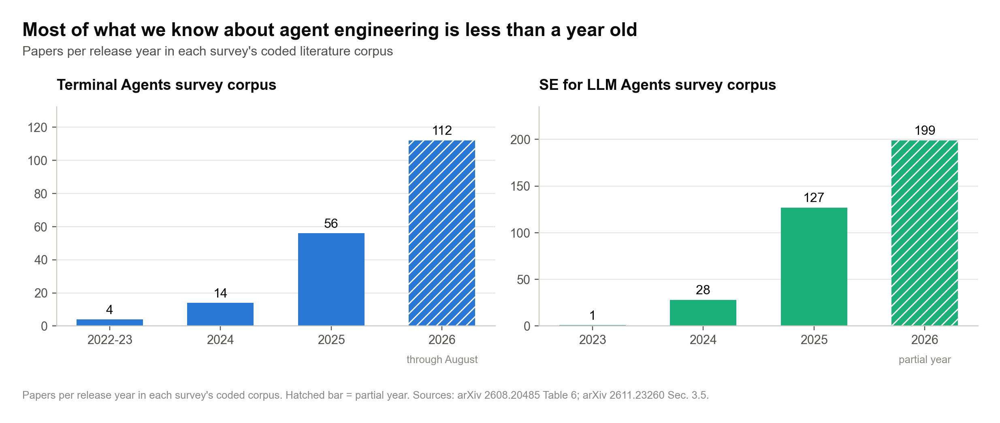 I also pulled fresh numbers from the public Terminal-Bench, SWE-bench and Vals AI leaderboards on 19 November 2026, because a survey's leaderboard table goes stale within weeks.

---

## Part 1: Where the engineering effort lives has moved four times

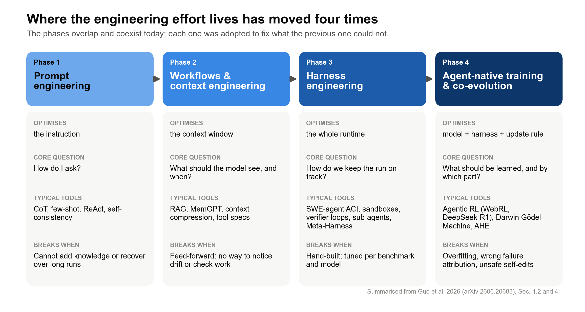

The harness survey frames the last few years as four overlapping phases. What changes between them is the thing you are optimizing.

1. **Prompt engineering** optimizes the instruction. Chain-of-thought, few-shot examples and ReAct all live here. The authors' framing is that prompting solves an *expression* problem: how to ask. It cannot supply knowledge the model lacks, and it cannot recover from a mistake ten steps ago.
2. **Workflows and context engineering** optimize what the model sees and when: retrieval, memory paging in the style of MemGPT, compressed history, tool descriptions. It is still feed-forward. Nothing in the design notices that the run has drifted.
3. **Harness engineering** makes the whole runtime the design object. Sandboxes, checkpoints, verifier loops, retries, sub-agents and permission gates close the loop. The question changes from "what do I show the model" to "how do I keep this run on track".
4. **Agent-native training and co-evolution** pushes some of that behaviour back into the weights through agentic RL, and lets the harness and the model be updated together from traces.

The phases coexist. Most production agents in late 2026 combine careful prompts, managed context, a real harness, and a model that was post-trained on tool use. What the framing does well is explain *why* each phase arrived: each one was adopted to fix a failure the previous one could not handle.

---

## Part 2: Anatomy of a harness

The survey formalizes an agent as a pair of model and harness, and then splits the harness into six coupled runtime responsibilities. Their one-line summary is worth quoting: "agent performance is a property of the model–harness pairing" (Guo et al., 2026).

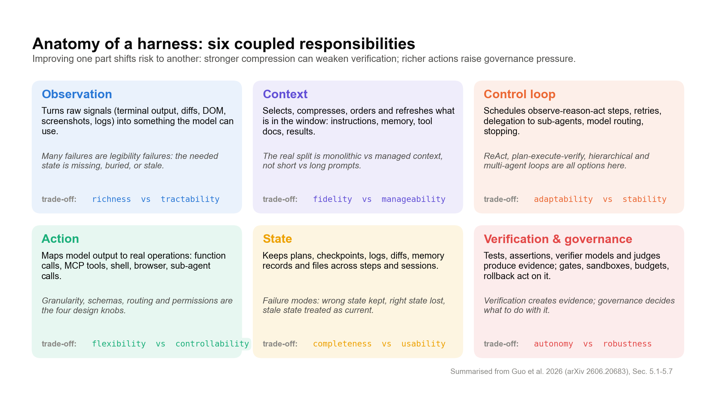

**1. Observation.** This is how raw signals become model input: terminal output, diffs, DOM trees, screenshots, logs. A lot of agent failures turn out to be *legibility* failures. The information the model needed was missing, buried in noise, or stale. The key technique here is the **Agent-Computer Interface (ACI)** popularized by SWE-agent. Instead of raw `cat` and `sed`, the agent gets a small set of search, view and edit commands whose output is shaped for a language model, such as windowed file views and concise error messages. The survey points out that ACI redesign alone improved SWE-bench results with the base model held fixed.

**2. Context.** This decides what enters the window, in what form, and when it gets refreshed. The survey argues the important distinction is between a *monolithic* context and a *managed* one, and that prompt length matters less. Techniques include compaction (summarizing old turns), "folding" finished sub-tasks into short notes, loading skills and tool docs only on demand, and writing task state to files instead of carrying it in the transcript.

**3. Control loop.** This decides who acts next and when to stop. The options run from a plain ReAct loop, to plan-execute-verify, to hierarchical sub-agents and model routing, where a cheap model handles easy steps and a strong one handles hard ones. The trade-off is adaptability against stability.

**4. Action.** This maps model output to real operations: function calls, MCP tools, shell commands, browser actions, sub-agent invocations. The four design knobs are granularity (one big `bash` tool or many narrow APIs), schema strictness, routing and interoperability, and permissions.

**5. State.** This covers what persists across steps and sessions: plans, checkpoints, diffs, logs, memory records. The failure modes are easy to recognise from real projects. The wrong state gets kept, the right state cannot be found, or stale state is treated as current.

**6. Verification and governance.** Tests, linters, assertions, verifier models and LLM judges produce *evidence*. Sandboxes, approval gates, budgets, rollback and safe termination decide what to *do* with it. The survey separates these two halves cleanly, and I found that separation one of its most useful ideas.

The six parts are coupled, so improving one shifts risk into another. Aggressive compression can starve the verifier of the evidence it needs. A richer action space raises the bar for permissions and rollback. Persistent memory can resurface stale facts. In my experience this is why harness changes that look obviously good in isolation sometimes make an agent worse overall.

### Picking the harness from the task

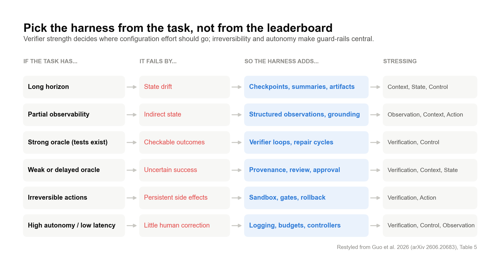

The survey also maps task properties to failure pressures and to the harness pieces that respond. It sorts tasks into four complexity levels and names the main bottleneck for each:

| Level | Example tasks | Main harness bottleneck |
|---|---|---|
| L1 single-step | search, translate, calculate | context; verification |
| L2 multi-step | form filling, code generation | action interface; state; verification |
| L3 long-horizon | repo-scale coding, research | context; state; control loop |
| L4 open-ended | monitoring, autonomous exploration | verification and governance; control loop |

It treats the jump from L2 to L3 as the one that matters most. Domains differ by their dominant bottleneck: coding is verification-dominant (tests exist), web and GUI work is grounding-dominant, research is synthesis-dominant, medicine is safety-dominant, and embodied agents are control-dominant. The practical lesson is to match the harness to the oracle. If tests exist, invest in verify-and-repair loops. If success can only be judged later, invest in provenance, review and conservative stopping.

---

## Part 3: What the leaderboards actually show

This is where the harness survey earns its place. It treats public leaderboards as observational data and asks how much a score moves when only one side of the model-harness pair changes.

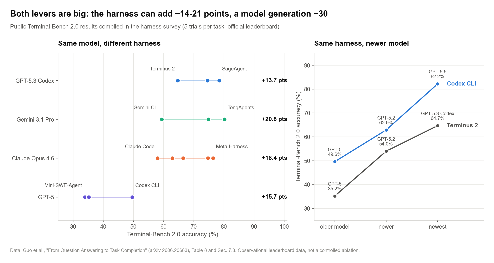

**Same model, different harness.** On Terminal-Bench 2.0, GPT-5.3 Codex ranges from 64.7% (Terminus 2) to 78.4% (SageAgent), a spread of 13.7 points. Claude Opus 4.6 ranges from 58.0% (Claude Code) to 76.4% (Meta-Harness), 18.4 points. Gemini 3.1 Pro ranges from 59.4% (Gemini CLI) to 80.2% (TongAgents), 20.8 points. Across the 20 models that appear with at least three harnesses, the median spread is 13.6 points, and 14 of the 20 vary by at least 10.

**Same harness, newer model.** The survey is honest that this cuts both ways. Inside Terminus 2, moving from GPT-5 to GPT-5.3 Codex lifts the score from 35.2% to 64.7%. Inside Codex CLI, moving from GPT-5 to GPT-5.5 lifts it from 49.6% to 82.2%. That is roughly 30 points per model jump, bigger than the typical harness spread.

On SWE-bench Verified the picture is similar. GPT-4o resolves 23.2% of issues under the original SWE-agent and 38.8% under Agentless. One finding I like: under Claude Opus 4.5, the roughly 100-line mini-SWE-agent scores 76.8%, almost the same as the full OpenHands runtime at 77.6%. Adding more scaffolding does not automatically help.

On the web the effect is even larger, because a bare model is so weak at browsing.

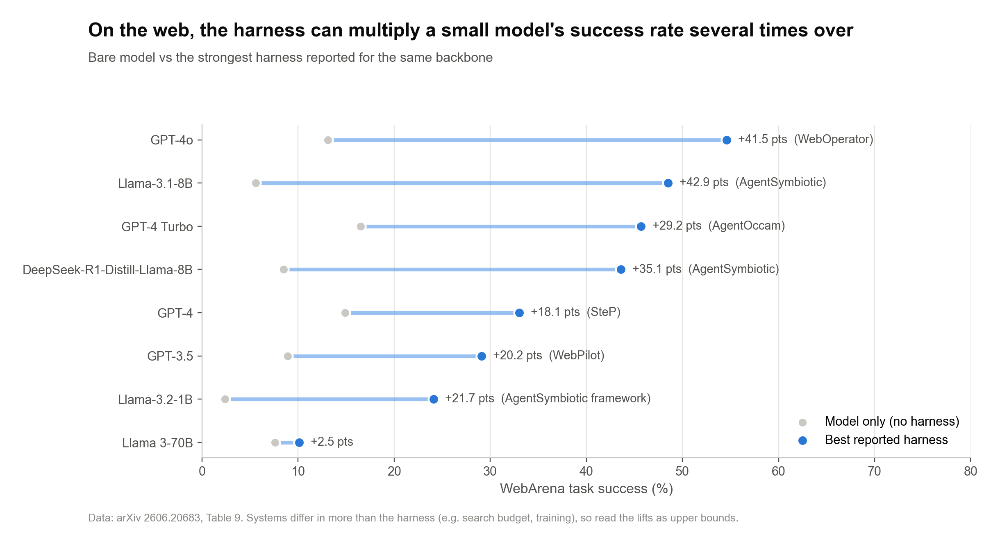

GPT-4o goes from 13.1% as a bare model to 54.6% with WebOperator. Llama-3.1-8B goes from 5.6% to 48.5% with AgentSymbiotic. One caveat matters here: these systems differ in more than the harness. Some use tree search with many more environment interactions, and some involve extra training. Read these lifts as upper bounds.

### The techniques behind the top entries

Reading the harness descriptions in the survey and on the leaderboards, the high-scoring systems share a small set of moves:

- **Searched or generated harnesses.** Meta-Harness treats prompts, tools and runtime policies as a search space and optimizes them against the benchmark. SageAgent uses an agent-generation engine to write and refine its own scaffold. This is the "learnable harness" idea in practice, and it is powerful. It also carries an obvious risk of overfitting to the benchmark it is searched on.
- **Verification before stopping.** Terminus-KIRA's design centres on completion checks before the agent declares success. As Part 4 shows, unforced agents often skip this step, so building it into the loop is one of the cheapest wins available.
- **Minimal, legible action spaces.** mini-SWE-agent and Mux show that a small, transparent tool loop on a strong model is a very competitive baseline. Simple harnesses are also much easier to debug.
- **Structured pipelines when the oracle is strong.** Agentless and PatchPilot replace the open-ended loop with fixed localize, repair and validate stages. They are cheaper and more reproducible, and they compete well on narrow, checkable tasks.
- **Spending tokens on context, on purpose.** The best harnesses often read a lot more than the reference harness does.

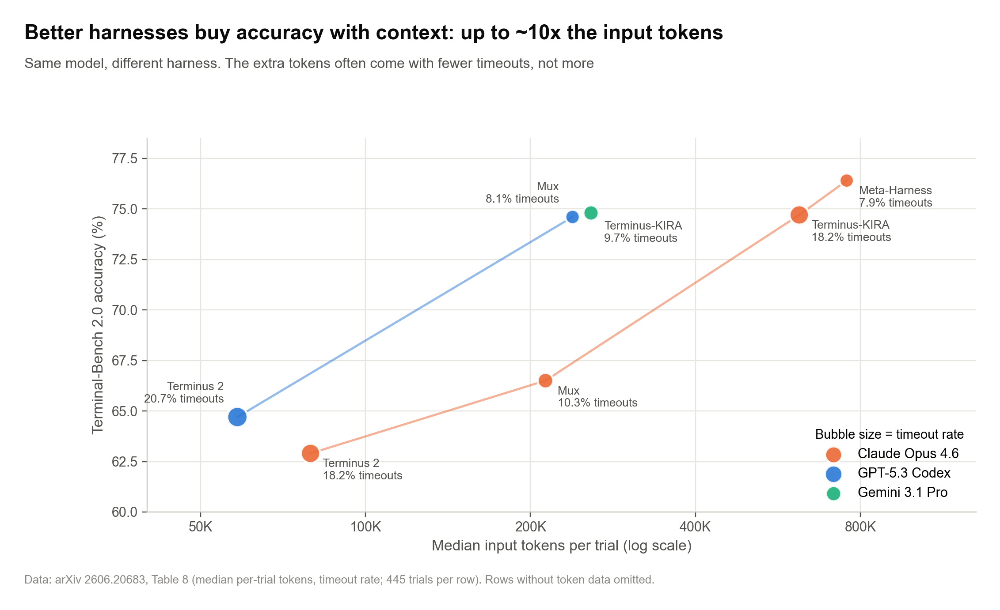

That last point is the most under-discussed result in the survey. For Opus 4.6, Meta-Harness uses a median of 755K input tokens per trial against 79.4K for Terminus 2, about 9.5 times as many. It also cuts timeouts from 18.2% to 7.9% and adds 13.5 points of accuracy. Better harnesses are not free. They trade money for reliability, and a leaderboard that shows only accuracy hides that trade.

---

## Part 4: Deep dive on terminal agents, including a real ablation

The *Terminal Agents* survey zooms into the environment where most coding agents actually work. It defines a terminal agent by its execution substrate rather than by its interface. If running commands, reading their output and changing persistent state is what drives progress, it counts as a terminal agent. A chat assistant that happens to have a CLI wrapper does not.

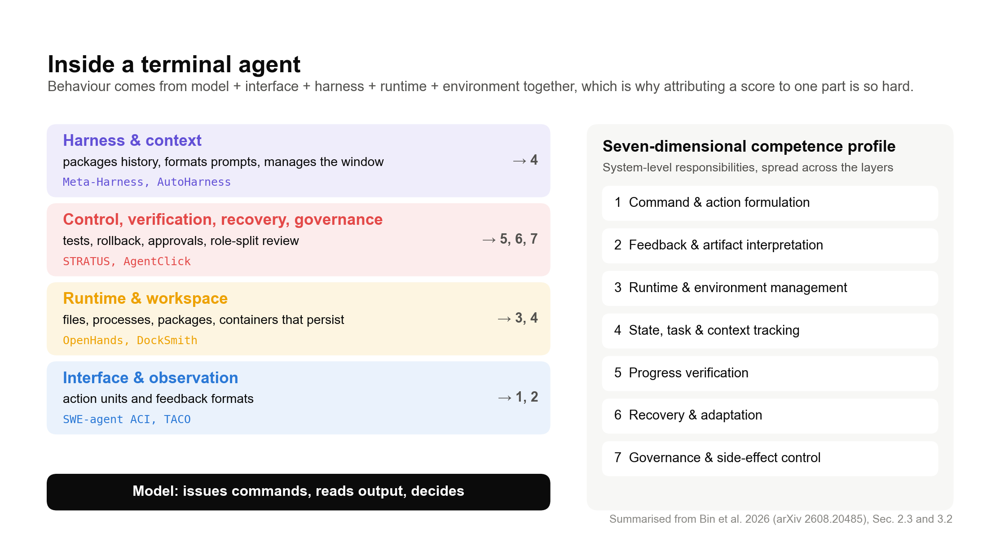

It describes the architecture as four layers on top of the model: interface and observation, runtime and workspace, control and verification, and harness and context. It also proposes a **seven-dimensional competence profile**: command formulation, feedback interpretation, runtime management, state tracking, progress verification, recovery, and governance. These are responsibilities of the whole system, spread across the layers, not abilities of the model alone.

### The ablation: change the harness or change the model?

What sets this survey apart is that the authors ran their own matched experiment. They used two DeepSeek-V4 variants (Flash and the larger Pro) under three harnesses (mini-SWE-agent, SWE-agent, OpenHands) on identical task sets, with temperature 0, one run per task, and paired statistical tests.

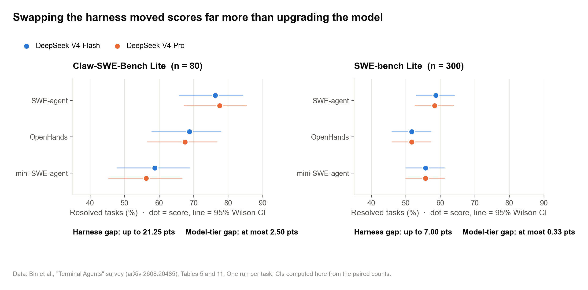

The result is striking:

- **Changing the model tier barely mattered.** Pro minus Flash never exceeded 2.5 points in any setting, and no difference survived multiple-comparison correction.
- **Changing the harness mattered a lot, depending on the benchmark.** On Claw-SWE-Bench Lite, SWE-agent beat mini-SWE-agent by up to 21.25 points, a statistically significant gap. On SWE-bench Lite the largest harness gap was only 7 points.
- **Rankings flipped between benchmarks.** OpenHands beat mini-SWE-agent on one benchmark and lost to it on the other.

They also ran one fixed agent (mini-SWE-agent with V4-Flash) across four benchmark families and logged process indicators such as feedback use, final verification, recovery and governance triggers.

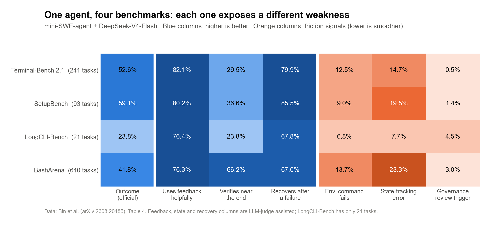

Each benchmark exposes a different weakness. SetupBench stresses environment bootstrapping. LongCLI-Bench has the lowest success (23.8%) and the hardest long-horizon demands. BashArena shows the most state-tracking errors and governance-relevant commands. The agent ran a verification step near the end of only 24 to 37% of tasks on three of the benchmarks.

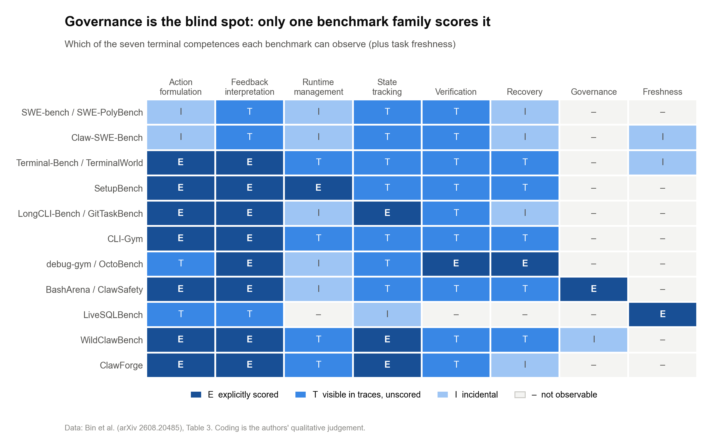

The survey's coverage map shows which competences each benchmark can even observe. Command formulation and feedback interpretation are well covered. Governance, meaning permissions, sandboxing and side effects, is explicitly scored only by the BashArena and ClawSafety family. Most benchmarks reward getting the right answer and do not penalize doing something dangerous along the way. The survey also cites an audit that found about 16% of tasks across five terminal benchmarks could be reward-hacked.

---

## Part 5: Harnesses that improve themselves

If the harness matters this much, the natural next step is to let the agent improve its own harness. The Schmidhuber-group survey formalizes exactly that. An agent is a pair of weights θ and a scaffold Σ, and the scaffold breaks into prompts, memory, tools and control logic. Self-improvement is any lasting update the agent makes to either part using a signal it produced itself.

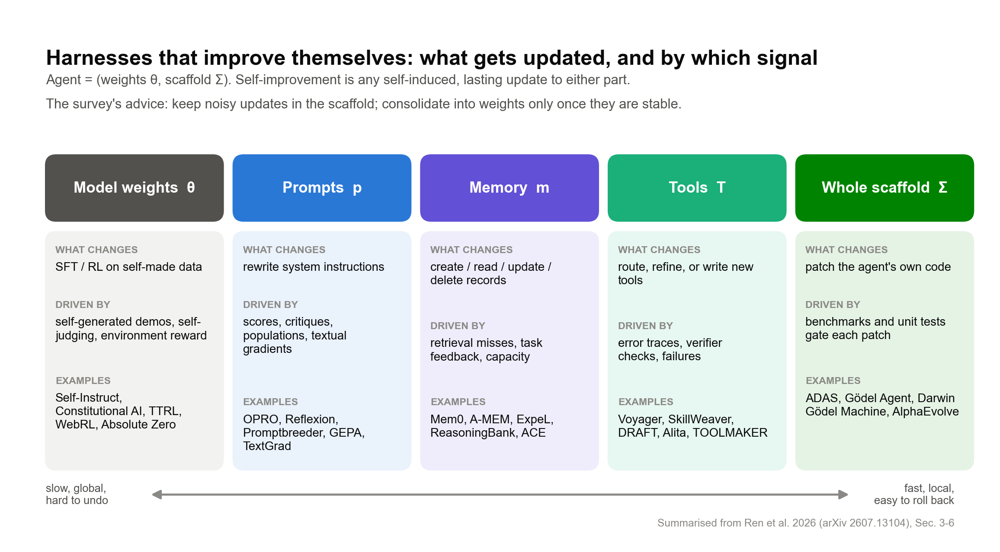

The taxonomy is two-dimensional: *what* gets updated and *which signal* drives the update.

- **Weights** are updated with self-generated data, self-judging, or environment reward (Self-Instruct, Constitutional AI, TTRL, WebRL, Absolute Zero). These updates are slow, global and hard to undo.
- **Prompts** are improved by four families of optimizer, ordered by how much information the feedback carries: scalar scores (OPRO, APE), written critiques (Reflexion, ACE), evolving populations (Promptbreeder, GEPA), and "textual gradients" (TextGrad).
- **Memory** is treated as create, read, update and delete operations over stored experience (Mem0, A-MEM, ExpeL, ReasoningBank).
- **Tools** can be routed, refined or written from scratch (Voyager, SkillWeaver, DRAFT, Alita).
- **The whole scaffold** can be patched as code, with each change gated by tests (ADAS, Gödel Agent, Darwin Gödel Machine, AlphaEvolve).

The headline example is the Darwin Gödel Machine. It keeps the foundation model frozen and lets an archive of coding agents rewrite their own source code, keeping only changes that score better.

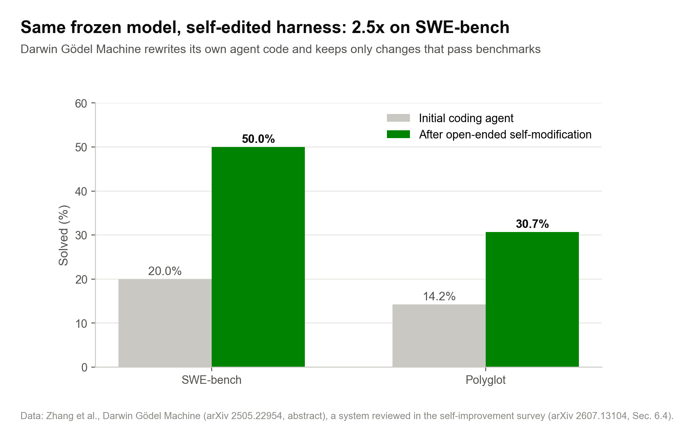

Per the DGM paper, this lifted SWE-bench from 20.0% to 50.0% and Polyglot from 14.2% to 30.7%. The discovered improvements were harness features: better editing tools, long-context management, and peer-review steps. In effect it automated harness engineering.

The survey also tabulates 25 memory systems, and one gap stands out.

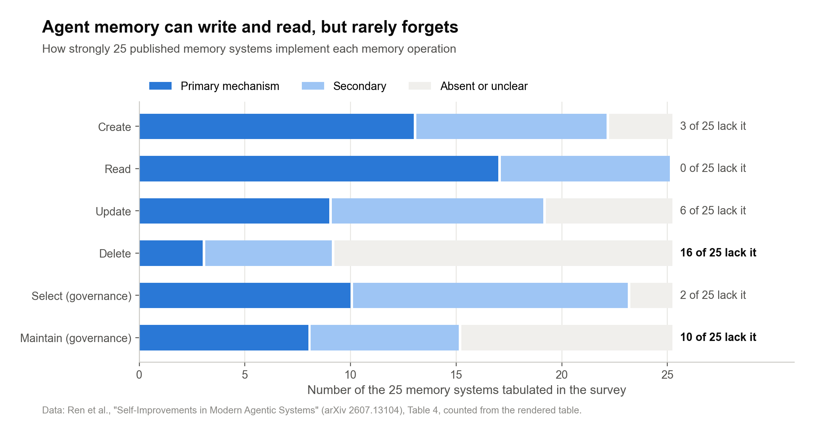

Almost every system writes and reads memory, but 16 of the 25 have no real delete or forgetting mechanism. For a long-running agent, memory that never forgets is memory that eventually lies to you.

On evaluation, the survey makes three recommendations I would adopt as rules:

1. Report the whole improvement *trajectory* under a fixed budget, not just the final score.
2. Track regressions on tasks the agent could already solve.
3. Never let the same judge both drive the updates and report the results.

Its safety advice is "layered gating": treat a self-modifying agent like untrusted code, and make every patch pass functional, permission and robustness checks before it is kept.

---

## Part 6: Shipping it, the AgentOps view

The fourth survey asks the question that matters once a demo works. If an agent is a product, how is it engineered across its life? The authors map 355 published papers onto five software lifecycle stages.

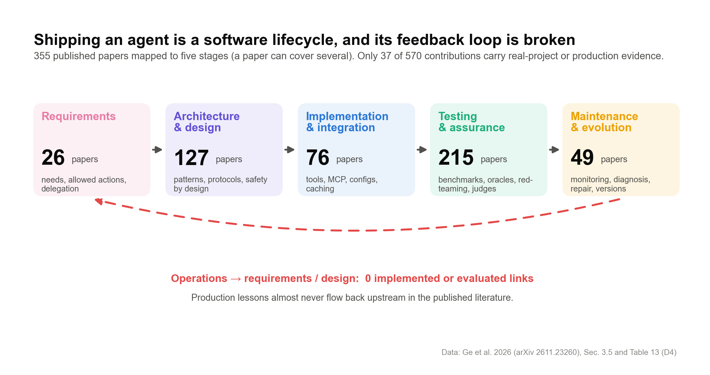

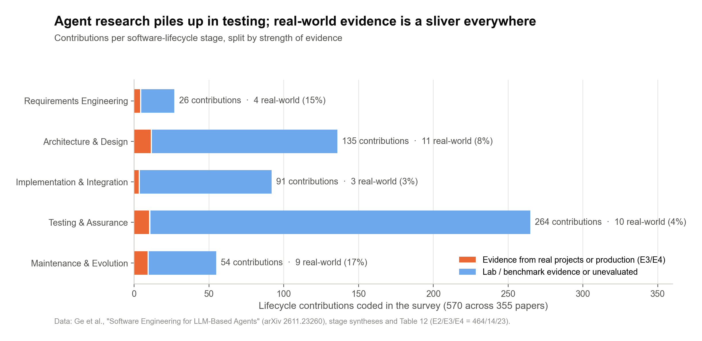

Three findings stood out to me:

- **Testing dominates.** 215 of the 355 papers address testing and assurance, against only 26 for requirements. The field is much better at measuring agents than at specifying what they should and should not do.
- **Evidence is mostly lab-grade.** Of 570 coded contributions, only 37 come with evidence from real projects or production. That is about 6.5%.
- **The feedback loop is broken.** The authors found no implemented or evaluated link from operations back to requirements or design. Production incidents get patched locally and do not flow back into the spec.

The survey's motivating example is Anthropic's multi-agent research system. The team could not tell whether bad answers came from the queries, the source selection or the tools until they added production tracing. Long-running stateful agents also forced rolling deployments in which old and new versions ran side by side. These are software-engineering problems, not model problems.

The AgentOps practices the survey collects are useful in their own right:

- **Testing:** specification-driven test generation that separates "the test environment broke" from "the agent is wrong"; policy-aware success metrics, where a run counts only if it is both successful and compliant; and attack suites that report utility, utility under attack, and attack success separately.
- **Repeated runs:** report pass@k (any of k attempts succeeds) and all-pass@k (every attempt succeeds) together. The second number is the one that matters to a user.
- **Runtime guardrails:** pre-action permission checks, capability limits, formal monitors over traces, and circuit breakers.
- **Regression:** versioned prompt components, offline evaluation gates before a model migration, and step-level evaluation in CI. One industrial pilot raised 23 regression alerts in four months. Eight were genuine, twelve borderline, and three false positives.

---

## Part 7: The metrics that matter

Pulling the four surveys together, this is the metric set I would want on any agent result:

| Metric | What it tells you | Where it comes from |
|---|---|---|
| Success rate with a 95% CI | Did it work, and how sure are we | All four |
| pass@k and pass^k (all-pass@k) | Capability versus reliability | SE survey; harness survey ("Rel_k") |
| Cost per successful task | Real economics, not cost per attempt | Harness survey (value-aware objective) |
| Median tokens, wall-clock, timeout rate | Where the budget goes | Harness survey, Table 8 |
| P95 latency | User-facing speed | Harness survey |
| Final-window verification rate | Does it check before saying "done" | Terminal survey (P5) |
| Recovery rate after a failure | Can it get unstuck | Terminal survey (P6) |
| Governance trigger rate | Risky commands and side effects | Terminal survey (P7) |
| Regression on solved tasks | Did the update break something | Self-improvement survey |
| Policy-compliant completion | Success that also obeyed the rules | SE survey |

The harness survey wraps several of these into a "value-aware" objective: maximize the expected value of successful, high-quality runs subject to budgets on cost, latency, risk and reliability. It does not compute that objective for any system, which is a missed opportunity, but the framing is right.

---

## My two cents

### 1. "It's the harness, not the model" is half true

The harness-first framing is a useful correction to model-only leaderboards, but the survey's own numbers show model upgrades moving Terminal-Bench by about 30 points inside a fixed harness, against a median harness spread of 13.6. The terminal survey's clean "model tier barely matters" result compares two variants of one model family. My reading is that the model sets the ceiling and the harness decides how much of it you actually reach. If you are choosing where to spend engineering time, the harness is usually the cheaper lever. That does not make it the larger one.

### 2. Harness rankings are not stable facts

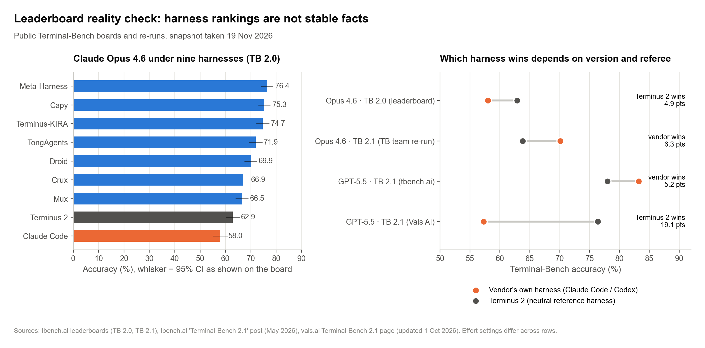

I checked the live boards on 19 November 2026, and the rankings move a lot:

- On the Terminal-Bench 2.0 board, Opus 4.6 under Claude Code (58.0%) trails Terminus 2 (62.9%).
- In the Terminal-Bench team's own re-run on the corrected 2.1 task set, the order reverses: 70.1% for Claude Code against 63.8% for Terminus 2.
- On the 2.1 board, GPT-5.5 scores 83.2% in Codex and 78.0% in Terminus 2.
- Vals AI's independent run of the same benchmark puts GPT-5.5 at 57.3% in Codex and 76.4% in Terminus 2.

The benchmark version and the team running the evaluation can matter as much as the harness. The Terminal-Bench maintainers also had to publish an integrity policy in 2026 after finding cheating and reward hacking on the leaderboard. Treat any single harness ranking as one measurement, not as a fact about the harness.

### 3. Vendor CLIs at the bottom is not a scandal

Claude Code and Gemini CLI sit near the bottom of the ranges for their own models on Terminal-Bench 2.0. I do not think that means they are bad harnesses. Product CLIs are built for interactive work with permission prompts and a human in the loop, while leaderboard harnesses are tuned for unattended, benchmark-shaped tasks. Some top harnesses are literally searched against the benchmark. The surveys call for testing whether harness gains transfer across tasks and model families. Nobody has reported that test yet, and until someone does, I would discount benchmark-tuned harness results.

### 4. Cost is the missing axis

Only 15.2% of Terminal-Bench trial records carry dollar-cost fields, and the harness survey had to drop cost from most of its comparisons for that reason. The live 2.1 board now shows cost, and it is revealing. For the full benchmark run listed on the board, GPT-5.5 in Codex used about 0.7B tokens (about $2.1k), against about 0.1B tokens (about $0.5k) in Terminus 2, for a 5-point gain. Whether that gain is worth four times the spend depends on the product. A leaderboard should let you decide that.

### 5. Governance and forgetting are the blind spots

Governance is explicitly scored by one benchmark family. Forgetting is missing from 16 of 25 memory systems. Operational feedback reaches requirements in none of the 355 papers. All three gaps point the same way: the field optimizes for *finishing tasks* far more than for *being safe to leave running*. That is fine for a benchmark and not fine for production.

### 6. A few things to check before you cite these surveys

All four are recent first versions, and each has rough edges. The harness survey's Table 7 groups different model versions under one row label, and some of its percentages and percentage-point figures are mixed up. The terminal survey's diagnostics use a single model family, a single run per task, and an LLM judge from the same family as the agent. The self-improvement survey reports almost no numbers of its own; its evidence lives in the primary papers. The SE survey analyses only formally published papers, which leaves out most of the preprints, vendor posts and open-source work where AgentOps practice actually happens. None of this undermines their taxonomies, but it is a reason to check the primary source behind any number you cite.

### My synthesis: the harness report card

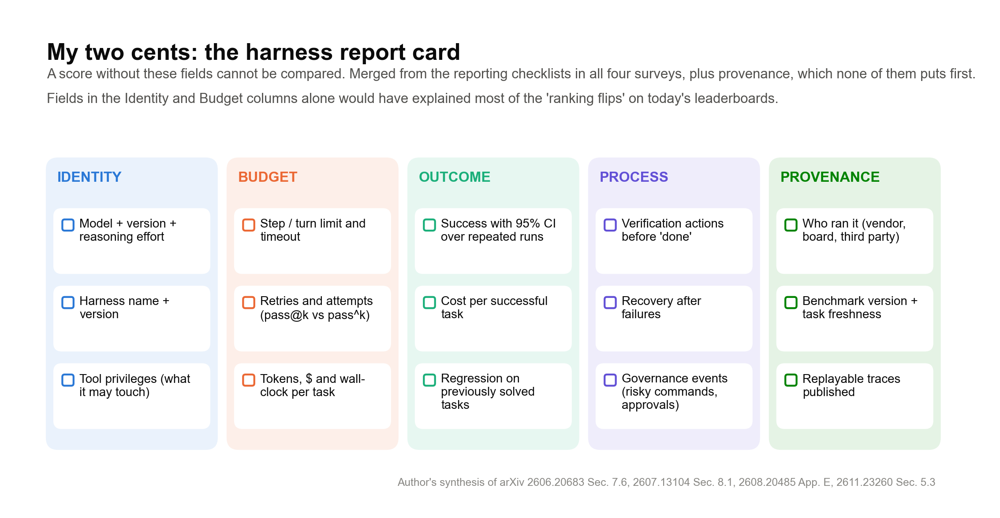

If I could add one convention to the field, it would be this card. Every agent result should state which model and harness were used, the budget, the outcome with uncertainty, a few process signals, and who ran the evaluation. The identity and budget fields alone would explain most of the ranking flips above.

---

## A practitioner's checklist

1. **Start minimal.** A small, legible tool loop on a strong model is the baseline to beat. Add pieces only when a trace shows you need them.
2. **Match the harness to the oracle.** If tests exist, build a verify-and-repair loop. If they do not, add provenance, review and conservative stopping.
3. **Manage context deliberately.** Compact, fold finished sub-tasks, load skills on demand, and write state to files.
4. **Gate irreversible actions.** Use a sandbox by default, approvals for side effects, and keep rollback paths.
5. **Measure reliability, not just capability.** Report pass^k alongside pass@k, and use repeated runs with confidence intervals.
6. **Put cost on the same chart as accuracy.** Cost per successful task is the number your finance team will ask for.
7. **Trace everything and feed it back.** Production traces should change your specs and your harness, not just trigger a hotfix.
8. **If you let the agent improve itself,** keep noisy updates in the scaffold, gate every change with held-out tests, and never grade with the same judge that guided the change.

---

## Conclusion

The four surveys agree on the main point. An LLM agent is a system, and its behaviour comes from the model, the harness, the runtime and the evaluation together. They differ in emphasis. The harness survey gives the vocabulary, the terminal survey gives the cleanest experiment, the self-improvement survey shows where automation is heading, and the SE survey shows how much engineering discipline is still missing. My own takeaway after reading them side by side is that strong models are becoming a commodity, and the harness is becoming the place where products differ. It deserves the same rigour we gave to models: controlled comparisons, honest cost accounting, and results reported with their full configuration.

---

### References

1. J. Guo et al., "From Question Answering to Task Completion: A Survey on Agent System and Harness Design," arXiv:2606.20683, Jun. 2026. Companion list: github.com/ggjy/Awesome-Agent-Engineering
2. Z. Ren et al., "Self-Improvements in Modern Agentic Systems: A Survey," arXiv:2607.13104, Jul. 2026. Project page: selfimproving-agent.github.io
3. Y. Bin et al., "Terminal Agents: A Survey of AI Agents in Command-Line Environments," arXiv:2608.20485, Aug. 2026. Companion list: github.com/EnigmaYYYY/awesome-terminal-agents
4. Y. Ge et al., "Software Engineering for LLM-Based Agents: A Lifecycle-Oriented Survey," arXiv:2611.23260, Oct. 2026.
5. J. Zhang et al., "Darwin Gödel Machine: Open-Ended Evolution of Self-Improving Agents," arXiv:2505.22954.
6. Terminal-Bench leaderboards (2.0 and 2.1), the "Terminal-Bench 2.1" post, and the "Leaderboard Integrity Update" post, tbench.ai, accessed 19 Nov 2026.
7. Vals AI, Terminal-Bench 2.1 results page (updated 1 Oct 2026), vals.ai, accessed 19 Nov 2026.

*All charts were drawn by me from numbers reported in these sources. The data files and plotting scripts are in the GitHub repository linked below, so every figure can be regenerated and checked.*

---

**Companion materials:** GitHub repository with data, code and slides: <!--GITHUB-->https://github.com/nitishsjsucs/agent-harness-engineering-survey<!--/GITHUB--> · Slide deck: <!--SLIDESHARE-->SlideShare link coming soon<!--/SLIDESHARE--> · Video walkthrough: <!--YOUTUBE-->YouTube link coming soon<!--/YOUTUBE-->
